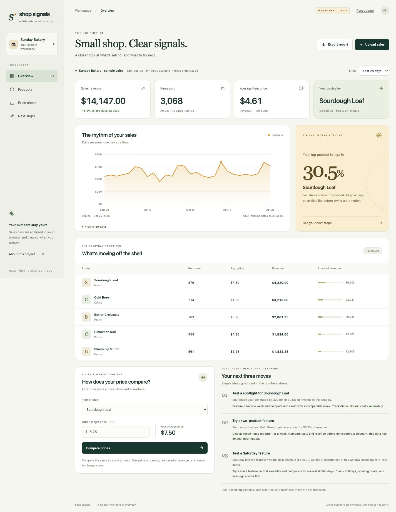

# Shop Signals

A browser-based sales dashboard that turns a small shop’s CSV into revenue trends, product rankings, and practical questions to investigate.

[Open the demo](https://boongmsba.github.io/shop-signals/) · [Read the build guide](docs/BUILD_GUIDE.md) · [View automated checks](https://github.com/Boongmsba/shop-signals/actions/workflows/test.yml)

Shop Signals is an original portfolio project with its own code and Git history. It was built with AI assistance; it does not reuse the `crumbs` source code or claim its contributors’ work.



## What it does

- Starts with 56 days of synthetic bakery sales so you can explore immediately.
- Accepts an uploaded or pasted sales CSV and validates dates, quantities, prices, and required columns.
- Shows revenue, units sold, top products, and a daily revenue trend.
- Filters to all available dates or the latest 7, 28, or 56 calendar days in the dataset.
- Compares revenue with the previous equal-length period when the file reaches the start of that period.
- Offers rule-based action cards backed by the selected sales data.
- Compares a product’s selling price with a competitor price you enter manually.
- Exports the analysis as a JSON file.

All calculations run in your browser. Uploaded sales and manually entered prices stay in memory for the current page session and reset on refresh. There is no database, account system, analytics service, or external AI API.

## Run locally

You need Python 3 and a modern browser. From this project’s folder, run:

```bash
python3 -m http.server 8000 --bind 127.0.0.1
```

Open [http://127.0.0.1:8000](http://127.0.0.1:8000) in your browser. Keep the terminal open while using the app; press `Ctrl+C` to stop the server. Use the local server rather than opening `index.html` directly because the app uses JavaScript modules.

No package installation, API key, or build step is required.

## Bring your own CSV

Use these exact column names. `category` is optional:

```csv
date,product,quantity,unit_price,category
2026-10-01,Sourdough Loaf,12,8.50,Bread
2026-10-01,Butter Croissant,20,4.25,Pastry
2026-10-02,Sourdough Loaf,9,8.50,Bread
```

| Column | Expected value |
| --- | --- |
| `date` | A valid date in `YYYY-MM-DD` format, year 1900 or later |
| `product` | A nonempty product name |
| `quantity` | A positive whole number of units sold |
| `unit_price` | A nonnegative USD price per unit, with up to two decimal places and no currency symbol |
| `category` | Optional category name |

The upload limit is 2 MiB and 50,000 data rows. Each row is a sales record, which may summarize multiple units. Revenue is `quantity × unit_price`; a row is not necessarily a customer order. For a ready-to-use example, see [data/sample-sales.csv](data/sample-sales.csv).

## Check the calculations

With Node.js 22 or newer installed, run:

```bash
npm test
```

Or run the built-in Node test runner directly:

```bash
node --test
```

The 14-test suite exercises CSV validation, exact-cent revenue, weighted averages, UTC date windows, short-data recommendations, and competitor comparisons. It does not require npm dependencies. GitHub Actions also runs it on pushes to `main` and pull requests. Also check the browser flow when changing the interface: load the demo, switch date windows, upload a CSV, enter a competitor price, and export the analysis.

## Project structure

```text
index.html               Page structure and accessible controls
styles.css               Layout, colors, and responsive styles
src/app.mjs              Browser events and dashboard rendering
src/analytics.mjs        CSV parsing, calculations, and action rules
data/sample-sales.csv    Synthetic example data
tests/analytics.test.mjs Calculation and input-validation tests
docs/BUILD_GUIDE.md      Step-by-step explanation and GitHub workflow
```

## What the numbers mean

- Revenue is sales value, not profit. Costs, tax, shipping, discounts, and returns are not modeled.
- Prices are interpreted as USD. This version does not convert currencies or support fractional quantities or negative return rows.
- A date without records counts as zero revenue. Missing data and a genuinely quiet day are indistinguishable.
- The all-dates view supports spans up to 100 years. A shorter date filter can be used for wider source files.
- Date windows end on the latest date in the file, not today. This makes historical files useful without changing their dates.
- Action cards use explicit rules. They are prompts for investigation, not forecasts or proof that a change will improve sales.
- Competitor information is entered manually. There is no live scraping or automatic price feed, and product comparability is up to the user.
- The included data is synthetic. Its results do not demonstrate real customer outcomes or business impact.

## Build on it

Read the [step-by-step build guide](docs/BUILD_GUIDE.md) for how the project fits together, how to publish an independent GitHub repository, and how to make your first change. Useful extensions include cost-of-goods data for gross margin, custom date comparisons, and additional CSV formats.
